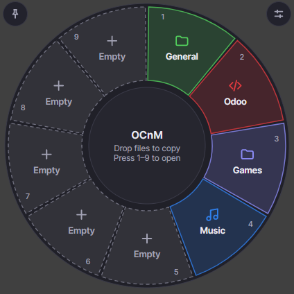

# OCnM: Open, Copy 'n' Move

**Drop files onto a donut slice to copy or move them into a folder. 9 slices, 9 folders.**

<p align="center"></p>

## What is it?

OCnM is a small round menu with **9 slices**. You give each slice a folder you use a lot (Downloads, Photos, Work,
a game folder, …). After that:

- **Open**: click a slice and its folder opens.
- **Copy**: drag files onto a slice and they are copied into that folder.
- **Move**: hold **Shift** while you drop, and the files are moved instead of copied.

No more digging through folders to save a file. It is free, works offline, needs no account and sends nothing anywhere.

## Install

Pick your system. You don't need to install anything else first.

### Windows 10 / 11

1. Download **`ocnm-win-x64.zip`** from the **[Releases page](https://github.com/JustStartingNow/OCnM/releases/latest)**.
   (Only if your PC is the rare ARM kind, such as a Snapdragon laptop, take `ocnm-win-arm64.zip` instead.)
2. Right-click the zip and choose **Extract All**. Put the extracted folder somewhere permanent, for example
   `Documents\OCnM`, because the app runs from where it is.
3. Double-click **`ocnm.exe`**.
   Windows may show a blue box, *"Windows protected your PC"*, because the app isn't signed yet. Click
   **More info → Run anyway**. You only do this once.
4. OCnM is now running in the background. Press **Ctrl+Alt+Space**, or click its icon next to the clock
   (it may be hidden under the **^** arrow), and the donut appears.

> The Windows version is new and has not been tried on many PCs yet. If something doesn't work,
> please [open an issue](https://github.com/JustStartingNow/OCnM/issues).

### macOS

1. Open **Terminal** (press **⌘ Space**, type *Terminal*, press Enter).
2. Paste this line and press Enter:

   ```bash
   curl -fsSL https://raw.githubusercontent.com/JustStartingNow/OCnM/master/install.sh | sh
   ```

3. When it says *Installed*, start OCnM with `ocnm --toggle`. Run it again to hide the donut.

> The macOS version has not been tried on a real Mac yet. If it doesn't work for you, please
> [open an issue](https://github.com/JustStartingNow/OCnM/issues).

### Linux

1. Open a terminal, paste this line and press Enter:

   ```bash
   curl -fsSL https://raw.githubusercontent.com/JustStartingNow/OCnM/master/install.sh | sh
   ```

2. Start OCnM with `ocnm --toggle`. OCnM also appears in your app menu.
3. **Make a keyboard shortcut** so you can open the donut anytime. Set a shortcut that runs `ocnm --toggle`:

   | Your desktop | Where |
   |---|---|
   | KDE Plasma | System Settings → Keyboard → Shortcuts → Add New → *Command or Script* |
   | GNOME | Settings → Keyboard → Custom Shortcuts |
   | Niri, Hyprland, Sway | Add a keybind in your config; examples in the [advanced guide](docs/ADVANCED.md#niri) |
   | An X11 session | Nothing to do: **Ctrl+Alt+Space** already works |

Prefer to look at the script before running it? It is [`install.sh`](install.sh), short and readable. It downloads the
right build for your computer, checks it, and puts it in your home folder (no admin password needed).

## Your first minute

1. **Open the donut** (Windows: **Ctrl+Alt+Space**; Mac and Linux: your shortcut or `ocnm --toggle`).
2. **Give a slice a folder.** Click a slice marked **+** and pick a folder. Or drag a folder from your file manager onto
   an empty slice.
3. **Copy something.** Drag a file onto that slice. A message at the bottom confirms it, with an **Undo** button.
4. **Open the folder.** Click the slice. (Or press the number key **1–9** shown on it.)
5. Press **Esc** to hide the donut.

### Handy things to know

| I want to… | Do this |
|---|---|
| **Move** files instead of copying | Hold **Shift** while dropping (or right-click the slice → *Drop action* → *Always move*) |
| **Undo** a drop | Click **Undo** in the message at the bottom |
| Rename a slice, change its color or icon | **Right-click** the slice. For any color you like, choose *Change color → Custom color…* |
| Change a slice's folder | Right-click → *Change folder…* |
| Empty a slice | Right-click → *Clear slice* |
| Open all settings | Click the sliders button at the top right |
| Keep the donut open while dragging from another window | Click the **pin** at the top left first |
| Use the keyboard | **Arrow keys** choose a slice, **Enter** opens it, **Menu** key shows its options |

### Is it safe for my files?

- OCnM **never overwrites** a file. If the name is taken, the new one becomes `name (1).ext`. (In Settings you can
  choose to skip or to be asked instead.)
- You can't drop a folder into itself, and **Undo** puts things back. If you edited a copied file afterwards, Undo
  leaves it alone.
- **Move** to another drive is copied, checked, and only then removed from the original place.

## Update

- **Linux and macOS:** run the install line again.
- **Windows:** download the new zip, close OCnM (right-click its tray icon → *Quit*), and replace `ocnm.exe`.

Your slices and settings are kept.

## Uninstall

- **Windows:** right-click the tray icon → *Quit*, then delete the folder you extracted. Your settings are in
  `%APPDATA%\OCnM` (delete that too if you like).
- **Linux and macOS:**

  ```bash
  curl -fsSL https://raw.githubusercontent.com/JustStartingNow/OCnM/master/install.sh | sh -s -- --uninstall
  ```

  Your settings stay in `~/.config/ocnm` (Linux) or `~/Library/Application Support/OCnM` (Mac) until you delete them.

## Something not working?

| Problem | What to try |
|---|---|
| **Windows says "protected your PC"** | Click **More info → Run anyway**. It appears because the app isn't signed yet |
| **I can't find the donut on Windows** | Press **Ctrl+Alt+Space**, or look for the OCnM icon near the clock (under **^**) |
| **`ocnm: command not found`** | Close the terminal and open a new one. If it still fails, the installer printed one line telling you how to add `~/.local/bin` to your PATH |
| **Linux: my shortcut does nothing** | Check the command is exactly `ocnm --toggle`, and that no other shortcut uses the same keys |
| **Linux: dragging files from the file manager doesn't work** | Open Settings: the footer should say *Backend: Wayland (native)* on a Wayland desktop. See the [advanced guide](docs/ADVANCED.md#linux-backends-native-wayland-vs-x11) |
| **The donut disappears when I click my file manager** | Click the **pin** at the top left of the donut first, then drag |
| **A slice turned orange with a warning** | Its folder was moved or deleted. Click the slice and pick the folder again |
| **macOS: "cannot be opened because the developer cannot be verified"** | Use the install line above (it avoids this). If you downloaded the file by hand: System Settings → Privacy & Security → **Open Anyway** |

Still stuck? [Open an issue](https://github.com/JustStartingNow/OCnM/issues) and say which system you use. If you can,
attach the file `ocnm.log` from your settings folder.

## For developers and power users

Building from source, the command-line options, the config file, compositor setups (Niri, Hyprland, Sway) and the
internals are in the **[advanced guide](docs/ADVANCED.md)** and [ARCHITECTURE](docs/ARCHITECTURE.md).
What changed in each version: [CHANGELOG](CHANGELOG.md).

---

Inspired by the donut idea of [Filee](https://github.com/KnifeLemon/Filee) (MIT). OCnM is original code and does not
convert files. Licensed under the [MIT License](LICENSE).
